<!-- BBN:HEADER:START -->

<!-- BBN:HEADER:END -->

# Codex Agent World

Codex Agent World คือเว็บออฟฟิศ 3D (Three.js + React) ที่อ่านไฟล์ agents/openai.yaml ของ skills ในโฟลเดอร์ ~/.codex (หรือ $CODEX_HOME) แล้วสร้างโต๊ะทำงานให้เอเจนต์แต่ละตัว ต้องใช้ Node.js 22.13 ขึ้นไป ติดตั้งด้วย npm install แล้วรัน npm run dev ซึ่งจะ sync รายชื่อเอเจนต์ลง app/data/agents.generated.json ก่อนเปิดเว็บ

<!-- BBN:FOOTER:START -->
---

**สร้างโดย [BoomBigNose](https://github.com/Boom-Vitt)** · [Kruoop.com](https://kruoop.com) แหล่งเรียน AI + คอมมูนิตี้ · [Seeneo.ai](https://seeneo.ai) · [YouTube 220K](https://www.youtube.com/@BoomBigNose)

ถ้าโปรเจกต์นี้มีประโยชน์ กด ⭐ ให้กำลังใจกันได้เลย

<!-- BBN:FOOTER:END -->
